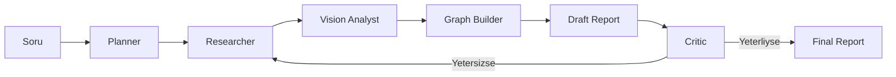

# Omni-Analyst: Multimodal GraphRAG & Autonomous Research Agent

Omni-Analyst, bir insanin yaptigi arastirma surecini (planlama, veri toplama,
gorsel analiz, raporlama ve kendini duzeltme) otonom sekilde taklit eden
cok-ajansli bir sistemdir. LangGraph uzerinde bir state machine olarak
kurgulanmistir.

## Ozellikler
- Agentic workflow (planlama -> arastirma -> VLM -> GraphRAG -> rapor -> critic)
- Multimodal veri cikarma (web + PDF + gorsel)
- Kaynakli rapor ve karsilastirma tablosu
- Metrik bazli kaynak/guven ibaresi (pdf/web/none + high/medium/low)
- Streamlit arayuzu (soru girisi + tablo/rapor goruntuleme)

## Mimari Akis
1. Planner Agent: Soruyu alt gorevlere boler.
2. Web Research: Guncel kaynaklari toplar.
3. Multimodal Analysis: Grafik/tablolari VLM ile metne cevirir.
4. Knowledge Graph: Neo4j'e entity/relationship yazar (GraphRAG).
5. Critic/Reflection: Eksikleri yakalar ve arastirmayi tekrarlar.
6. Report: Kaynakli rapor ve karsilastirma tablosu uretir.

## Mimari Diyagram


## Ornek Cikti
```text
Karsilastirma Tablosu:
| Sirket | Donem | Gelir | Gelir Kaynak/Guven | Brut Marj | Brut Marj Kaynak/Guven | Faaliyet Geliri | Faaliyet Geliri Kaynak/Guven | Net Kar | Net Kar Kaynak/Guven | EPS | EPS Kaynak/Guven |
| --- | --- | --- | --- | --- | --- | --- | --- | --- | --- | --- | --- |
| NVIDIA | Q1FY26 | $44062 | web/medium | 60.5% | web/medium | $21638 | web/medium | $18775 | web/medium | $0.76 | web/medium |
```

## Hizli Baslangic (CLI)
```bash
python -m venv .venv
.\.venv\Scripts\activate
pip install -r requirements.txt
python -m omni_analyst.app
```

## Hizli Baslangic (Streamlit)
```bash
pip install -r requirements.txt
streamlit run streamlit_app.py
```

## Ortam Degiskenleri
- `GEMINI_API_KEY` (veya `GOOGLE_API_KEY`)
- `TAVILY_API_KEY` (opsiyonel)
- `NEO4J_URI`, `NEO4J_USER`, `NEO4J_PASSWORD`
- `USE_SELENIUM=1` (opsiyonel, JS render gerektiren sayfalar icin)
- `SELENIUM_HEADLESS=1`
- `ALLOW_DOMAINS` (virgulle ayrilmis allowlist, or: `nvidia.com,sec.gov`)
- `MODEL_TEXT` ve `MODEL_VISION` (Gemini model adini override etmek icin)
  - Ornek: `gemini-2.0-flash`, `gemini-flash-latest`
- `ENABLE_PDF_IMAGES=1` (PDF sayfalarini gorsele cevirip VLM'e gonderir)
- `PDF_MAX_PAGES=2`, `PDF_MAX_IMAGES=4`, `PDF_MIN_IMAGE_BYTES=20000`
- `POPPLER_PATH` (pdftoppm.exe iceren klasorun tam yolu)

> Not: PDF sayfalarini gorsele cevirmek icin sistemde Poppler gerekir.
> Windows icin ornek: `choco install poppler` (ardindan PATH'e ekleyin).

## Neo4j (Docker)
```bash
docker compose up -d
```
Varsayilan giris:
- Kullanici: `neo4j`
- Sifre: `password`

## Sorun Giderme
- PDF tablo ciktilari harf harf gorunuyorsa, cikti temizleme raporda uygulanir.
  Daha iyi sonuc icin `PDF_MAX_PAGES` artirilabilir.
- VLM kullanimi yavas ise `ENABLE_PDF_IMAGES=0` ile kapatabilirsiniz.

## Notlar
Bu repo, iskelet ve ornek akisi barindirir. Gercek dunya calismasinda veri
toplama, VLM analizi ve grafik yazimi uretim altyapisina gore uyarlanmalidir.
